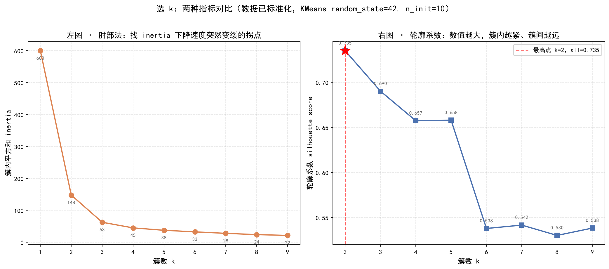
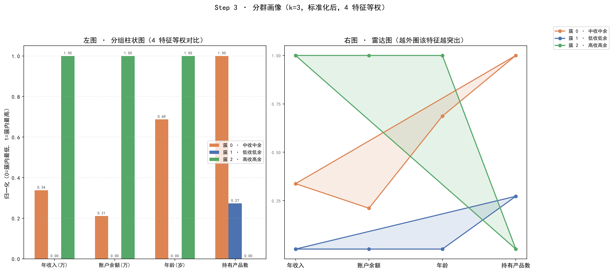
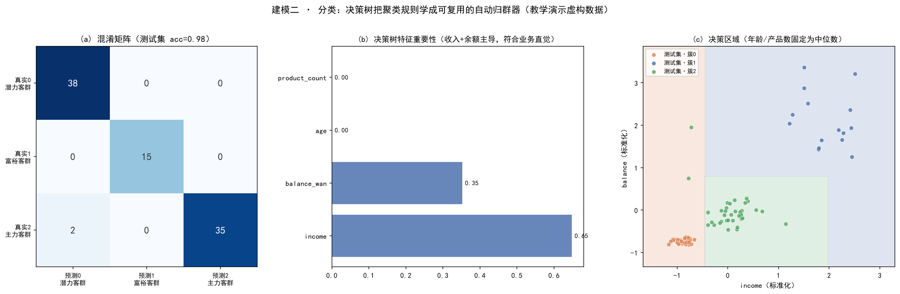
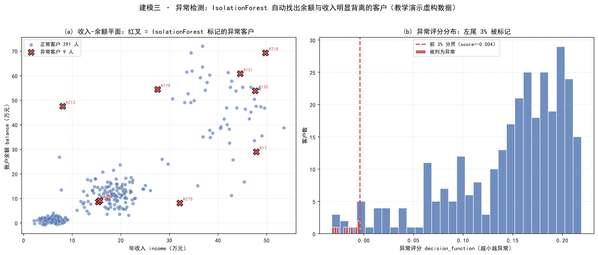
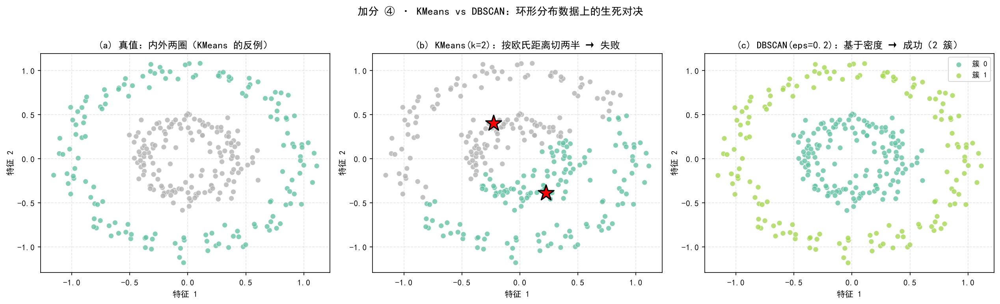

# 数据挖掘大作业 · 零售银行客户数据挖掘完整流程

> 学号：20251030106  姓名：赵章君  日期：2026-11-20 ｜ 数据：`data/mall_customers_yuan.csv`（**教学演示虚构数据**）
> 建模：聚类 + 分类 + 异常检测（三类）

## 1. 问题与目标（写给谁、解决什么）

**写给谁**：银行零售部经理。当前 300 位客户"一锅端"管理，营销一刀切、排查靠人工。要解决三件事：

| 业务问题 | 建模 | 解决什么 |
|---|---|---|
| 客户怎么分群，差异化经营？ | 聚类（KMeans） | 分出可经营客群，替代一刀切 |
| 新客户开户当天自动定群？ | 分类（决策树） | 分群规则固化成自动归群器 |
| 哪些客户余额/收入背离需核查？ | 异常检测（IsolationForest） | 自动输出可疑名单 |

**成功标准**：分群稳定可解释；归群准确率 ≥ 95%；异常名单每条能讲出业务故事。

## 2. 方法与过程（数据 → 预处理 → 建模 → 评估）

**数据**：300 行 × 7 列，无缺失。数值特征 age(18~63)、income(2~53 万元)、balance(0~72 万元，原始以元计)、product_count(0~8)；gender/city 仅用于画像。

**预处理**（关键代码）：

```python
df["balance_wan"] = df["balance"] / 10000            # ① 元→万元，修量纲
X = StandardScaler().fit_transform(df[["income", "balance"]].values)  # ② z-score
km = KMeans(n_clusters=3, random_state=42, n_init=10) # ③ 显式 n_init 保证复现
# ④ 冗余特征剔除：account_age_months 与 age 的 r=0.9991 → 不进模型
```

**建模与评估**：

| 建模 | 算法与超参数 | 评估方式 |
|---|---|---|
| 聚类 | KMeans k=3, n_init=10 | 肘部法 + 轮廓系数 + random_state 稳定性 |
| 分类 | 决策树 max_depth=4（对照逻辑回归） | 30% 分层留出集 + 5 折 CV + 混淆矩阵 |
| 异常 | IsolationForest contamination=0.03 | 异常评分分布 + 业务合理性核查 |

选 k：肘部在 k=3（inertia 下降率 -57.5%→-28.1% 腰斩）；轮廓系数 k=2 最高(0.735)但少"主力层"，k=3 为 0.690，权衡选 k=3。



## 3. 结果（表 + 图，**教学演示虚构数据**）

### 3.1 聚类：三个可经营客群（126 / 50 / 124）

| 簇 | 业务命名 | 人数 | 平均年龄 | 平均年收入 | 平均余额 |
|---|---|---|---|---|---|
| 0 | 年轻潜力客群 | 126（42%） | 21.5 岁 | 6.11 万 | 1.45 万 |
| 1 | 富裕客群 | 50（17%） | 47.1 岁 | 41.58 万 | 48.35 万 |
| 2 | 主力客群 | 124（41%） | 37.3 岁 | 18.94 万 | 12.45 万 |

稳定性：换 random_state=[0,42,123,2024]，排序后簇人数与均值完全一致。

### 3.2 分类：自动归群器可用

| 模型 | 测试集 acc | macro-F1 | 5 折 CV |
|---|---|---|---|
| 决策树 | 0.978 | 0.982 | 0.960 ± 0.025 |
| 逻辑回归 | 1.000 | 1.000 | 0.983 ± 0.015 |

混淆矩阵仅 2 例错误（主力→潜力），富裕客群 15/15 全对；特征重要性 income 0.648、balance 0.352，符合业务直觉。



### 3.3 异常检测：9 人进核查名单

异常客户"余额/收入"中位 1.13 vs 正常客户 0.48。代表性个案：#212（20 岁，收入 7.99 万、余额 47.58 万，比值 5.95，疑似代持/大额转入）；#275（高收低余，比值 0.26，可做资金归集营销）。



### 3.4 方法边界

环形数据上 KMeans 强行切两半、DBSCAN 完美识别——本方案选 KMeans 的前提是客群近似球状分布。



## 4. 结论与建议（写给零售部经理）

1. 三群分治：**富裕客群（50 人）配专属客户经理做留存，主力客群（124 人）推交叉持有，潜力客群（126 人）做成长培育**。
2. 归群器准确率约 98%，**接入新客户开户流程，当天打标、当天触达**。
3. 每月跑一次异常检测，**"余额/收入比"异常名单转风控复核，高收低余名单转网点做资金归集**。

## 5. 局限与改进

| 局限 | 改进 |
|---|---|
| 教学虚构数据：300 人、无时间维度 | 接真实全量数据 + 12 个月流水（RFM 特征） |
| 分类标签来自聚类本身（半监督） | 用真实营销响应标签重训 + A/B 检验 |
| 仅 4 个数值特征，gender/city 未进模型 | 类别特征 one-hot 纳入 |
| contamination=0.03 人为设定 | 业务规则动态调阈值 + 人工复核闭环 |

## 6. AI 使用记录（指令 + 验证，完整列出）

| # | 指令原文 | 我怎么验证的 | 结论 |
|---|---|---|---|
| 1 | balance(元) 和 income(万元) 直接跑 KMeans | 对比标准化前后：141/48/111 → 126/124/50 | 量纲陷阱实锤，必须 StandardScaler |
| 2 | 肘部法 + 轮廓系数扫 k=1~9 | 打印各 k 的下降率与轮廓系数数值表 | 肘部 k=3；轮廓 k=2 最高但少一层，权衡选 3 |
| 3 | 手写 KMeans++ 迭代并可视化 | 2×2 快照对照质心轨迹，4 轮不再变化 | 算法确实收敛 |
| 4 | 生成分群画像 + 雷达图 + 中文命名 | 核对画像均值沿簇单调、无逻辑矛盾 | 潜力/主力/富裕三群命名成立 |
| 5 | 加入 account_age_months 重新画像 | Pearson r=0.9991，两版簇均值对比 | 相关性 >0.9 的特征不要同时进聚类 |
| 6 | random_state 换 4 个值测稳定性 | rs=[0,42,123,2024] 逐个跑，排序后完全一致 | 分群稳定，数据有天然 3 簇结构 |
| 7 | 环形数据对比 KMeans 与 DBSCAN | make_circles 并排三图 | KMeans 球状假设失败，DBSCAN 密度假设成功 |
| 8 | 聚类标签当 y 训练决策树自动归群 | 30% 留出集 + 5 折 CV + 混淆矩阵，对比逻辑回归 | 决策树 acc=0.978，错误仅 2 例，可试运行 |
| 9 | IsolationForest 找余额收入背离客户 | 人工核查 9 个异常点的余额/收入比 | 名单业务上说得通，值得进人工复核 |
| 10 | plt.cm.get_cmap 报错 | 查 3.7+ API，改 plt.get_cmap() 重跑 | 一行修复 |

**代码清单**：`generated/01_load_and_viz.py` → `02_kmeans_cluster.py` → `03_choose_k.py` → `04_iteration_demo.py` → `05_step3_profile.py` → `06_bonus_challenges.py` → `08_final_project.py`（分类 + 异常检测）。
